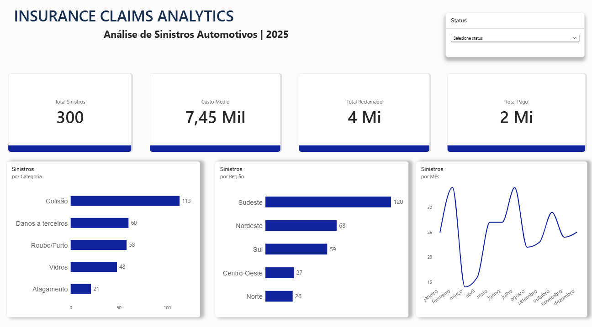

# Insurance Claims Analytics

### Automotive Insurance Claims Analysis | Python & Power BI

## Project Overview

This project analyzes a simulated dataset of 300 automotive insurance claims from 2025, focusing on claim frequency, financial performance, regional distribution, and monthly trends.

The objective is to demonstrate how data analytics can support decision-making in the insurance industry.

## Technologies Used

- **Python:** Data processing and analysis using built-in libraries.
- **CSV:** Dataset storage and manipulation.
- **Power BI:** Interactive dashboard development.
- **DAX:** Calculation of key performance indicators.
- **GitHub:** Project documentation and version control.

## Key Performance Indicators

| Metric | Result |
|---|---|
| Total Claims | 300 |
| Total Claimed Amount | R$ 3,745,376.60 |
| Total Paid Amount | R$ 2,235,991.78 |
| Average Payment per Claim | R$ 7,453.31 |

## Key Insights

**Claim Frequency:** Collision was the most frequent claim category, representing 113 occurrences (37.7% of the dataset).

**Financial Impact:** Theft and robbery generated the highest total paid amount, approximately R$ 875,537.

**Regional Distribution:** The Southeast region recorded the highest number of claims, with 120 occurrences.

**Monthly Trends:** February and July showed the highest claim frequencies.

## Dashboard Features

- Financial KPI cards
- Claims by category
- Regional claim distribution
- Monthly claims evolution
- Interactive claim status filter

## Dataset

The dataset contains 300 fictional automotive insurance claims created for educational and portfolio purposes. No real customer information was used.

## Project Objective

Demonstrate foundational skills in Python programming, data analysis, business intelligence, data visualization, and insurance analytics.